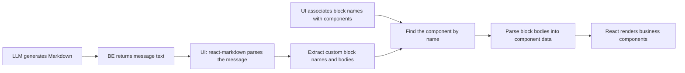
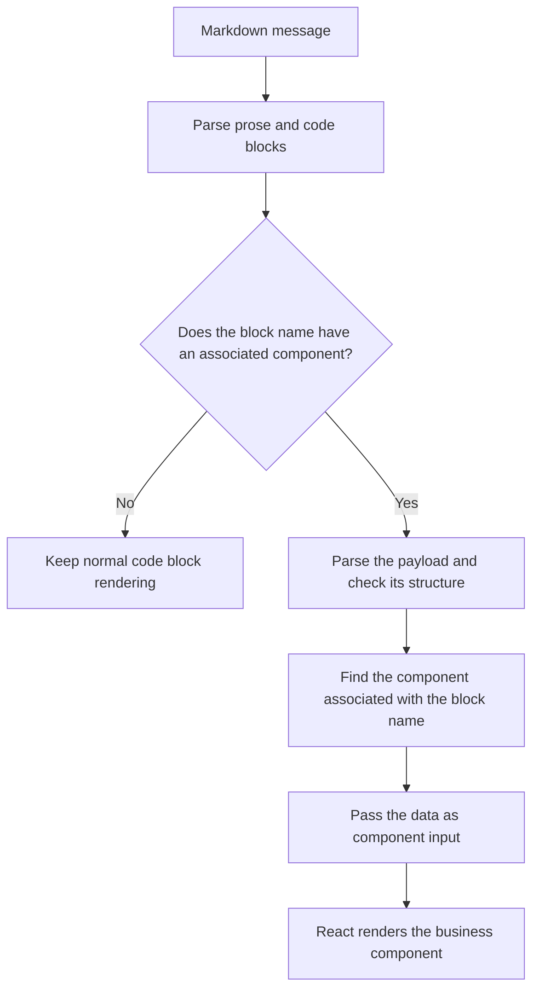

# From Markdown to Business Components: Code Block Rendering

[中文版](./CODE_BLOCK_COMPONENT_GUIDE.zh-CN.md)

LLMs commonly return answers as Markdown. Alongside headings, paragraphs, and lists, an answer can include custom fenced code blocks that the UI displays as business components, such as order summaries, product cards, or business tables.

This mechanism uses Markdown to carry the content, the code block name to select a component, and the block body to supply its data.

## 1. How the mechanism works

Three parts implement this mechanism in the UI:

- **Markdown renderer**: uses `react-markdown` to parse messages and identify prose and code blocks.
- **Name-to-component associations**: define in advance which React component corresponds to each code block name.
- **Payload parsing and rendering adapter**: converts custom block bodies into component data and renders the matching components.

The BE returns LLM-generated Markdown to the UI. The UI uses the predefined associations to find a component by block name and passes the block data as component input. Prose and ordinary code blocks keep their default Markdown rendering.



The block name selects the component, the body supplies its data, and the component implementation controls the display. An agreed data structure connects these parts.

## 2. How Markdown describes a component

For an order summary, the model might return:

````markdown
Here is the order summary:

```order-summary
{
  "orderId": "ORD-1001",
  "total": 128.5,
  "currency": "CNY"
}
```
````

The code block name `order-summary` tells the UI which component to use. The JSON body supplies the data required by that component. Prose before and after the block continues to render as normal Markdown.

The resulting UI can be understood as:

```text
A paragraph: "Here is the order summary:"
An order summary component: order ID, amount, and currency
```

JSON is the payload format used in this example. The essential requirement is a shared agreement between the UI and the model about the block name and its content structure.

## 3. How to associate code block names with components

The UI defines a set of associations in advance: when a particular code block name appears, which component should display it? For example:

| Code block name | Associated React component | Displayed content |
| --- | --- | --- |
| `order-summary` | `OrderSummary` | Order summary |
| `product-card` | `ProductCard` | Product card |
| `business-table` | `BusinessTable` | Business table |

These associations can be stored in a mapping indexed by name or maintained through the application's existing component management mechanism.

When the UI identifies `order-summary`, it finds `OrderSummary` by that name and passes in the order data parsed from the block. The name selects the component; the data determines what it displays.

The model outputs names and data. The UI supplies the actual React component implementations in advance; the model does not need to return React source code.

The same block name can appear multiple times in a message. Each block supplies its own data and becomes a separate component instance.

## 4. How custom blocks are parsed and rendered

The React UI uses `react-markdown` to parse a message into renderable nodes. Custom adapter logic recognizes and replaces code block nodes.

There are two distinct parsing stages:

1. **Markdown parsing**: identify prose, code blocks, their names, and their raw bodies.
2. **Payload parsing**: convert a block body into component data; for example, parse JSON into an object and check that its fields match the contract.



The component replaces the code block at its original position, allowing prose and components to appear in the order of the answer. Different blocks can use different components or reuse the same component type.

Successful Markdown parsing only means that the block can be recognized. It does not establish that the payload is complete or valid for the component. Rendering also depends on payload parsing and the component contract.
