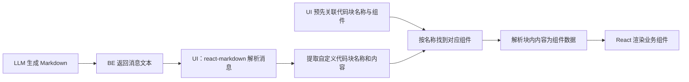
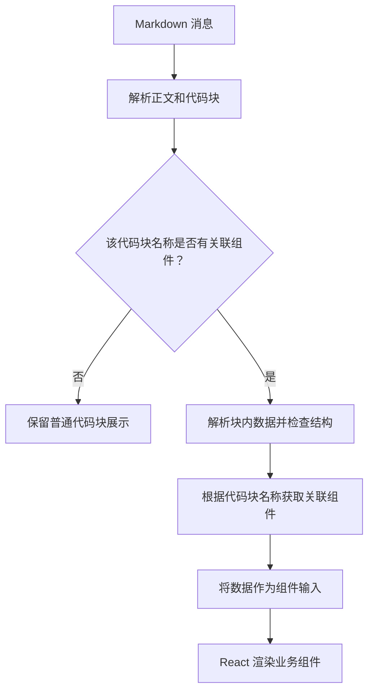

# 从 Markdown 到业务组件：基于代码块的渲染机制

[English version](./CODE_BLOCK_COMPONENT_GUIDE.en.md)

LLM 通常以 Markdown 返回回答。除了标题、段落和列表，我们也可以在回答中嵌入自定义代码块，让 UI 将其中的数据展示为业务组件，例如订单摘要、商品卡片或业务表格。

这套机制以 Markdown 承载内容，通过代码块名称选择组件，再把代码块内部的数据交给组件渲染。

## 一、整体工作机制

这套机制在 UI 侧由三个部分配合：

- **Markdown 渲染器**：使用 `react-markdown` 解析消息，识别正文和代码块。
- **名称与组件的关联关系**：在 UI 中预先约定每个代码块名称对应哪个 React 组件。
- **内容解析与渲染适配**：将自定义代码块的内容转换为组件数据，再交给对应组件渲染。

LLM 生成的 Markdown 由 BE 返回给 UI。UI 按预先约定的名称查找对应组件，将块内数据作为组件输入；正文和普通代码块继续使用 Markdown 的默认渲染。



代码块名称负责选择组件，代码块内容负责提供数据，组件实现负责实际展示。三者通过约定的数据结构连接。

## 二、Markdown 如何表达一个组件

以订单摘要为例，模型可以返回：

````markdown
以下是订单摘要：

```order-summary
{
  "orderId": "ORD-1001",
  "total": 128.5,
  "currency": "CNY"
}
```
````

这里的 `order-summary` 是 UI 用来识别组件的代码块名称，内部 JSON 是该组件需要的数据。代码块前后的正文仍然按普通 Markdown 展示。

UI 最终呈现的内容可以理解为：

```text
一段正文：“以下是订单摘要：”
一个订单摘要组件：展示订单号、金额和币种
```

JSON 只是本例采用的数据格式。机制的核心是：UI 与模型对代码块名称及其内容结构具有相同的约定。

## 三、如何将代码块名称与组件关联

UI 需要预先建立一组对应关系，说明“遇到某个代码块名称时，使用哪个组件展示”。例如：

| 代码块名称 | 关联的 React 组件 | 展示内容 |
| --- | --- | --- |
| `order-summary` | `OrderSummary` | 订单摘要 |
| `product-card` | `ProductCard` | 商品卡片 |
| `business-table` | `BusinessTable` | 业务表格 |

这些关系可以保存在以名称为索引的映射表中，也可以通过应用已有的组件管理机制维护。

当 UI 识别到 `order-summary` 时，便根据这个名称找到 `OrderSummary`，再将代码块内解析出的订单数据传给它。名称用于选择组件，数据用于决定组件显示什么。

模型负责输出名称和数据；React 组件的实际实现由 UI 预先提供。模型不需要返回 React 源码。

同一个代码块名称可以在一条消息中出现多次，每个代码块提供自己的数据，形成不同的组件实例。

## 四、自定义代码块如何被解析和渲染

React UI 使用 `react-markdown` 解析消息，将 Markdown 转换为可渲染的节点。自定义适配逻辑在代码块节点处进行识别和替换。

这里有两个不同的解析过程：

1. **Markdown 解析**：识别正文、代码块、代码块名称，以及块内原始文本。
2. **内容解析**：将代码块内的文本转换为组件需要的数据；例如把 JSON 文本转换为对象，并检查字段是否符合约定。



组件替换发生在代码块原来的位置，因此正文和组件可以按照回答中的顺序混合展示。不同代码块可以对应不同组件，也可以复用同一类组件。

需要区分：Markdown 解析成功，只代表代码块能够被识别，不代表块内数据已经完整或符合组件要求。数据是否可用于渲染，还取决于内容解析和组件契约。
